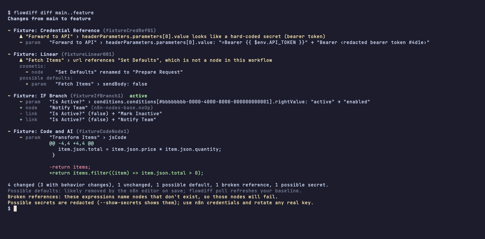

# flowdiff

[](https://github.com/akojif/flowdiff/actions/workflows/ci.yml)
[](LICENSE)

**Version control and readable diffs for n8n workflows.**

flowdiff pulls your n8n workflows into git as clean JSON files, shows what changed in terms of nodes, parameters and connections instead of raw JSON, and pushes your changes back to n8n with safety checks. It uses the n8n public API, so it works with any n8n instance (Community, self-hosted or Cloud) without server access.



```text
$ flowdiff diff main..feature
Changes from main to feature

~ Fixture: Credential Reference (fixtureCredRef01)
    ⚠ "Forward to API" › headerParameters.parameters[0].value looks like a hard-coded secret (bearer token)
    ~ param   "Forward to API" › headerParameters.parameters[0].value: "=Bearer {{ $env.API_TOKEN }}" → "Bearer ‹redacted bearer token #4d1e›"

~ Fixture: Linear (fixtureLinear001)
    ⚠ "Fetch Items" › url references "Set Defaults", which is not a node in this workflow
    cosmetic:
      ~ node    "Set Defaults" renamed to "Prepare Request"
    possible defaults:
      + param   "Fetch Items" › sendBody: false

~ Fixture: IF Branch (fixtureIfBranch1)  active
    ~ param   "Is Active?" › conditions.conditions[#bbbbbbbb-0000-4000-8000-000000000001].rightValue: "active" → "enabled"
    + node    "Notify Team" (n8n-nodes-base.noOp)
    - link    "Is Active?" (false) → "Mark Inactive"
    + link    "Is Active?" (false) → "Notify Team"

~ Fixture: Code and AI (fixtureCodeNode1)
    ~ param   "Transform Items" › jsCode
              @@ -4,4 +4,4 @@
                 item.json.total = item.json.price * item.json.quantity;
               }

              -return items;
              +return items.filter((item) => item.json.total > 0);

4 changed (3 with behavior changes), 1 unchanged, 1 possible default, 1 broken reference, 1 possible secret.
Possible defaults: likely removed by the n8n editor on save; flowdiff pull refreshes your baseline.
Broken references: these expressions name nodes that don't exist, so those nodes will fail.
Possible secrets are redacted (--show-secrets shows them); use n8n credentials and rotate any real key.
```

The demo uses made-up workflows; `node scripts/demo-repo.mjs <dir>` recreates it.

## Why

An n8n workflow is one large JSON document. Diff two versions with git and you mostly see noise: timestamps, version ids, reordered keys and moved nodes, with the real change buried somewhere in a 2,000-line file.

flowdiff normalizes workflows so pulling twice never creates a git change, and diffs them the way you think about them: a renamed node is a rename, a rewired IF branch says `true`/`false`, Code nodes and AI prompts get line-by-line diffs, and every change is marked as **behavior** or **cosmetic**. It also flags expressions that point at renamed nodes and tokens pasted into parameters.

It's built for teams who want Git-based review and CI checks for their workflows. On n8n Enterprise, the built-in Git source control may already cover your needs; flowdiff works with any edition via the public API and focuses on readable review and CI checks.

## Quick start

Requires Node.js 22 or later.

```sh
npm install -g @akojif/flowdiff   # installs the `flowdiff` command
```

Or run it without installing: `npx @akojif/flowdiff --help`.

```sh
mkdir n8n-workflows && cd n8n-workflows && git init
flowdiff init                       # instance URL, folder, optional tag
echo 'FLOWDIFF_API_KEY=…' >> .env   # n8n: Settings → n8n API (a read-only key is enough)
flowdiff pull && git add . && git commit -m "Baseline"

# …edit workflows in n8n or locally…
flowdiff status                     # what changed where
flowdiff diff                       # what push would change on the instance
flowdiff push --dry-run             # preview, then `flowdiff push`
```

## Commands

| Command           | What it does                                                                                                                              |
| ----------------- | ----------------------------------------------------------------------------------------------------------------------------------------- |
| `flowdiff init`   | Create `flowdiff.config.json` and offer to gitignore `.env` and `.flowdiff/`                                                              |
| `flowdiff pull`   | Download workflows as normalized JSON, one file per workflow; never overwrites local edits without `--force`                              |
| `flowdiff status` | Per workflow: unchanged, modified locally, modified on instance, conflict, deleted on instance…                                           |
| `flowdiff diff`   | What push would change; or `diff main..feature` between git refs, no instance needed. `--format markdown\|json`, `--exit-code [behavior]` |
| `flowdiff push`   | Upload local changes after showing the diff and asking. `--dry-run`, `--force`, `--apply-active`                                          |

Full flags, exit codes and JSON output: [docs/commands.md](docs/commands.md).

### Configuration

| Setting            | Where                  |                                                 |
| ------------------ | ---------------------- | ----------------------------------------------- |
| `instanceUrl`      | `flowdiff.config.json` | Your n8n URL. `FLOWDIFF_URL` overrides it.      |
| `workflowsDir`     | `flowdiff.config.json` | Folder for workflow files (default `workflows`) |
| `tag`              | `flowdiff.config.json` | Only track workflows with this tag              |
| `requireTag`       | `flowdiff.config.json` | Tag push requires on every workflow it touches  |
| `FLOWDIFF_API_KEY` | environment or `.env`  | n8n API key; never stored in the config file    |

**Use two API keys.** Keep a read-only key (`workflow:list`) in `.env` for `pull`, `status` and `diff`, and a separate key with only `workflow:list`, `workflow:read` and `workflow:update` for pushing. Shell variables win over `.env`, so you can pass the push key for one command: `FLOWDIFF_API_KEY="$FLOWDIFF_PUSH_KEY" flowdiff push`.

More, including the tag scope and push guard rules: [docs/configuration.md](docs/configuration.md).

## Safety design

Pushing to a live automation platform should be boring. Push:

- **shows the diff and asks first**, with `--dry-run` to preview; it refuses to run without an interactive terminal
- **backs up** the instance version to `.flowdiff/backups/` before every write
- **refuses conflicts**: if a workflow changed in n8n since your last pull, it stops unless you pass `--force`, and it re-checks right before writing
- **has a push guard**: it only touches workflows carrying the guard tag (`requireTag`), locally and in n8n, and pushes nothing until you configure one
- **never puts anything live by itself**: updates are sent with `publishIfActive=false`, and activation only changes with `--apply-active`
- **never sends `pinData` or `staticData`**, so pinned test data and trigger state stay as they are (verified against the live API)
- **never creates or recreates workflows**, and never deletes anything
- **asks again** before sending a workflow with broken references or a newly added secret
- **redacts secrets** in all output, unless you pass `--show-secrets`

Why each of these exists, and the n8n API behaviour behind them: [docs/how-it-works.md](docs/how-it-works.md).

## GitHub Action

> **Coming in a later release.** The Action isn't part of 0.1.0 yet.

Comment on pull requests with a readable diff of the workflow files they change, and optionally fail the check on behavior changes. It works from git alone: no n8n instance or API key.

```yaml
on:
  pull_request:
    paths: ['workflows/**']

permissions:
  contents: read
  pull-requests: write

concurrency:
  group: flowdiff-${{ github.event.pull_request.number }}
  cancel-in-progress: true

jobs:
  diff:
    runs-on: ubuntu-latest
    steps:
      - uses: actions/checkout@v4
        with:
          fetch-depth: 0
      - uses: akojif/flowdiff@v0
        with:
          fail-on: behavior # or: none, changes
```

The Action keeps one comment up to date, stays within GitHub's comment size limit (the full report goes to the job summary), and always redacts secrets. On pull requests from forks, GitHub doesn't allow the comment, so the report appears in the job summary instead. Details: [docs/github-action.md](docs/github-action.md).

## Limitations

- **The secret scanner is heuristic.** It catches common token formats and obvious patterns, not every secret. A clean result means "no known pattern found".
- **No workflow creation.** Push only updates workflows that already exist in n8n.
- **Tags and activation aren't pushed** by default. Tag changes are reported, not sent; activation needs `--apply-active`.
- **Possible-default noise.** The n8n editor removes parameters equal to their defaults when saving, so a workflow created through the API can show "possible defaults" after its first save. They're listed separately; pull again to refresh your baseline.
- **Workflow descriptions aren't synced.** The API's workflow list doesn't include them, and push leaves them untouched.
- **Missing-credential warnings** need the `credential:list` scope on the push key; without it, that check is skipped.
- **Tested against n8n 2.46.x.** n8n validates update requests strictly, so newer versions that add fields may need an update to flowdiff's allow-lists (push reports anything it had to drop).

## How I built this

_Coming soon._

## Development

```sh
npm ci
npm test          # Vitest; no network, n8n is faked
npm run lint && npm run typecheck && npm run build
```

The diff engine (`src/diff/`) and normalization (`src/normalize/`) are pure and tested on made-up fixtures in `test/fixtures/`.

## Disclaimer and license

flowdiff is an independent project. It is not affiliated with, endorsed by or sponsored by n8n GmbH. "n8n" is a trademark of n8n GmbH.

[MIT](LICENSE) © 2026 Francis Akoji
